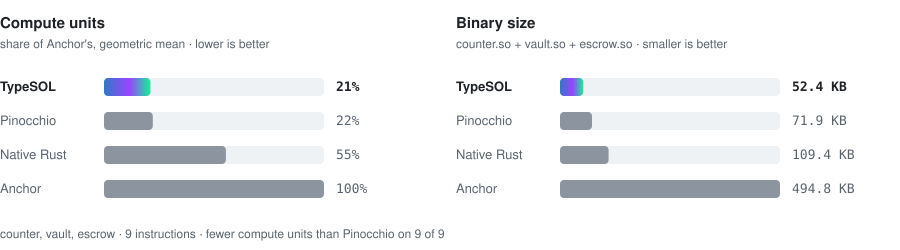

<p align="center">
  
</p>

<h3 align="center">Write Solana programs in TypeScript. Ship native SBF.</h3>

<p align="center">
  <a href="https://github.com/typesol/typesol/actions/workflows/ci.yml"></a>
  <a href="LICENSE"></a>
  <a href="CHANGELOG.md"></a>
  
</p>

<p align="center">
  <a href="https://typesol.com">Website</a> ·
  <a href="https://typesol.com/docs/">Docs</a> ·
  <a href="https://typesol.com/docs/changelog/">Changelog</a> ·
  <a href="#numbers">Benchmarks</a> ·
  <a href="docs/language.md">Language reference</a> ·
  <a href="https://x.com/type_sol">X</a>
</p>

TypeSOL compiles a TypeScript subset straight to Solana bytecode. It does not use an interpreter or a VM on chain, and
it does not generate Rust. Your `.ts` file is typechecked by the TypeScript compiler, lowered to C, and built with the
same LLVM toolchain that `cargo-build-sbf` uses. Every build also writes an **Anchor-compatible IDL**, so Anchor
clients read TypeSOL programs unchanged.

- **One language, end to end.** You write the program and its tests in TypeScript, and every build writes a typed
  client for it ([docs/client.md](docs/client.md)). Your editor gives you completion and type errors throughout.
- **Safe by default.**
  - Every arithmetic operation is checked.
  - Account owner, discriminator, signer, writability and aliasing checks are generated from your parameter types.
  - Constraints follow Anchor's rules and use Anchor's error codes.
- **Small and fast.** On the same programs, TypeSOL uses 5–46% of Anchor's compute units, with binaries about 10×
  smaller. It also uses fewer compute units than native Rust and than hand-tuned Pinocchio on every benchmarked
  instruction.
- **Reproducible.** The same sources and toolchain produce the same bytes. `typesol verify` reads a deployed program
  from the cluster and checks it, and the IDL published on chain, against its source.

<p align="center">
  <a href="#numbers">
    <picture>
      <source media="(prefers-color-scheme: dark)" srcset="assets/readme/benchmarks-dark.svg">
      
    </picture>
  </a>
</p>

## At a glance

**`counter.ts`**: a complete program, 23 lines.

```ts
import { type Init, type Mut, type Pubkey, type Signer,
         type SystemProgram, type u8, type u64, require } from "typesol";

export interface Counter {
  authority: Pubkey;
  count: u64;
  bump: u8;
}

export enum CounterError {
  Unauthorized = "Only the counter's authority can change it",
}

export function initialize(
  authority: Mut<Signer>,
  counter: Init<Counter>,
  systemProgram: SystemProgram,
): void {
  counter.bump = counter.create(authority, ["counter", authority.key]);
  counter.authority = authority.key;
  counter.count = 0n;
}

export function increment(authority: Signer, counter: Mut<Counter>, by: u64): void {
  require(counter.authority === authority.key, CounterError.Unauthorized);
  counter.count += by; // overflow-checked
}
```

<details>
<summary><b>The same program in Anchor</b>: 44 lines of Rust</summary>

```rust
#[program]
pub mod counter {
    use super::*;
    pub fn initialize(ctx: Context<Initialize>) -> Result<()> {
        let c = &mut ctx.accounts.counter;
        c.authority = ctx.accounts.authority.key();
        c.count = 0;
        c.bump = ctx.bumps.counter;
        Ok(())
    }
    pub fn increment(ctx: Context<Increment>, by: u64) -> Result<()> {
        let c = &mut ctx.accounts.counter;
        require_keys_eq!(c.authority, ctx.accounts.authority.key(),
                         CounterError::Unauthorized);
        c.count = c.count.checked_add(by)
            .ok_or(error!(CounterError::Overflow))?;
        Ok(())
    }
}

#[account]
#[derive(InitSpace)]
pub struct Counter { pub authority: Pubkey, pub count: u64, pub bump: u8 }

#[derive(Accounts)]
pub struct Initialize<'info> {
    #[account(mut)]
    pub authority: Signer<'info>,
    #[account(init, payer = authority, space = 8 + Counter::INIT_SPACE,
              seeds = [b"counter", authority.key().as_ref()], bump)]
    pub counter: Account<'info, Counter>,
    pub system_program: Program<'info, System>,
}

#[derive(Accounts)]
pub struct Increment<'info> {
    pub authority: Signer<'info>,
    #[account(mut)]
    pub counter: Account<'info, Counter>,
}

#[error_code]
pub enum CounterError {
    #[msg("Only the counter's authority can change it")]
    Unauthorized,
    #[msg("arithmetic overflow")]
    Overflow,
}
```

</details>

Both programs accept the same instructions and store the same account layout. The test suite sends identical
transactions to both and compares the results.

## Quick start

You need Node.js 22.12 or later and the Agave CLI (`sh -c "$(curl -sSfL https://release.anza.xyz/stable/install)"`).
Run `cargo-build-sbf --version` once; this downloads the platform-tools that TypeSOL compiles with. Rust is not needed.

```sh
npx @typesol/cli init my-app --name counter   # typesol.json, programs/counter.ts, tests/counter.test.ts, tsconfig
cd my-app && npm install
npm test                                      # builds the program and runs it in LiteSVM, an in-process Solana runtime
npx typesol build                             # target/counter/{counter.so, counter.json (IDL), counter.client.ts, counter.build.json}
npx typesol deploy --url http://127.0.0.1:8899 --keypair ~/.config/solana/id.json
```

`--template vault` or `--template escrow` starts from a SOL vault or an SPL token escrow instead of the counter, each
with a passing LiteSVM test.

The npm package is [`@typesol/cli`](https://www.npmjs.com/package/@typesol/cli). Projects install it under the name
`typesol`, which is what programs import (`import { … } from "typesol"`); `typesol init` sets that up. To add it to an
existing project: `npm install -D typesol@npm:@typesol/cli`.

Deploying again upgrades the program in place. Keep `target/deploy/<name>-keypair.json`: that keypair is your
program's address.

Coming from Anchor: [docs/migrate-from-anchor.md](docs/migrate-from-anchor.md) maps every construct, and `typesol port`
starts from your program's IDL. Tests use `typesol/testing` (accounts by name, plain values; [docs/test-your-program.md](docs/test-your-program.md)). To go to
mainnet (wallet, cost, deploy, IDL, verification), follow [docs/mainnet.md](docs/mainnet.md).

## How it works

```
counter.ts ─▶ tsc typecheck ─▶ subset check ─▶ C + typesol_rt.h ─▶ clang -target sbf ─▶ counter.so
                                      └────────────────────────────────────────────────▶ counter.json (Anchor IDL)
```

1. **Typecheck.** The TypeScript compiler checks your code against [`lib/typesol.d.ts`](lib/typesol.d.ts), which
   declares every TypeSOL type and built-in.
2. **Subset check.** TypeSOL rejects anything outside the language (floats, closures, classes, `any`, foreign imports)
   with a `file:line:col` diagnostic. Nothing is half-supported.
3. **Lower.** Instruction bodies become C. Account validation, checked arithmetic, Borsh encoding and CPI plumbing
   come from [`runtime/typesol_rt.h`](runtime/typesol_rt.h).
4. **Build.** The Agave platform-tools `clang` and `ld.lld` produce the `.so` (SBPF v0 by default; v1 and v2 with
   `--sbpf`).

Runtime failures point back to your source: `Error 6000 Unauthorized (counter.ts:21)`, or
`TypeSOL: arithmetic overflow (vault.ts:42)`.

## What you can write

| | |
| --- | --- |
| **Accounts** | `Signer`, `Account<T>`, `Mut<T>`, `Init<T>`, `InitIfNeeded<T>` (PDAs or keypair accounts, with Anchor's `space`; mints, token accounts and associated token accounts), `Zeroed<T>` (up to 10 MiB), optional accounts (`A \| null`), token accounts and mints, `SystemAccount`, programs, sysvars |
| **Constraints** | `HasOne`, `Seeds` (also from account fields and under another program; `pdaBump` like `ctx.bumps`), `CloseTo`, `Ata`, `Address`, `Owner`, `Executable`. They are checked before the body runs and recorded in the IDL |
| **Data** | `u8`…`u128`, `i8`…`i128`, `boolean`, `Pubkey`, `Hash`, nested structs, `FixedArray`, `FixedString`, `Option`, unit enums, data enums (discriminated unions), `Vec` that resizes its account, `FixedVec` lists anywhere, and Anchor's own byte layout (`@layout borsh`) to take over existing Anchor accounts and to pass, return and emit structs with String / Vec / Option fields as Anchor does |
| **Control flow** | `if`, `for`, `for … of`, `while`, `switch` (with narrowing on data enums), ternaries, `??`, destructuring, helper functions (returning structs too, arrow functions, closures, function arguments, generics), list callbacks (`some`, `find`, `reduce`, …) across multiple files |
| **CPIs** | System, SPL Token, Token-2022 (including extension reads and metadata), ATA, Metaplex Token Metadata, Core, Bubblegum. Generic `invoke` with PDA signing, return data, and typed bindings generated from any Anchor IDL (`typesol cpi`) |
| **Events** | `emit` (log-based) and `emitCpi` (Anchor `emit_cpi!`, through a self-CPI) |
| **Crypto & oracles** | `sha256`, `keccak256`, Merkle proofs, Ed25519 and secp256k1 signature checks, Pyth pull oracle, Switchboard |
| **Interfaces** | custom discriminators (`@discriminator`), so a TypeSOL program can be a Token-2022 transfer hook, with extra accounts (ExtraAccountMetaList) |

The full reference, with every type, check and built-in, is in [docs/language.md](docs/language.md).

## Tooling

| Command | What it does |
| --- | --- |
| `typesol init` | scaffold a project with a program, a LiteSVM test and TypeScript configs |
| `typesol build` | compile every program in `typesol.json`, or a single `.ts` file |
| `typesol check` | typecheck and subset-check without compiling |
| `typesol deploy` | `solana program deploy` with the right program keypair (`--dry-run` prints the commands) |
| `typesol idl publish` | upload the IDL to the Program Metadata program (canonical when the upgrade authority signs) |
| `typesol cpi <idl.json>` | generate typed CPI helpers for another program |
| `typesol client <idl.json>` | generate a typed TypeScript client from an Anchor IDL (`typesol build` writes one per program) |
| `typesol port` | a TypeSOL skeleton of an Anchor program from its IDL, keeping discriminators and error codes |
| `typesol/ts-plugin` | the compiler's errors in the editor as you type ([docs/cli.md](docs/cli.md#editor)) |
| `typesol verify` | rebuild from source and compare with the program and IDL on chain (or a dumped `.so`) |
| `typesol profile` | compute units per TypeScript line, from a `--profile` build's logs |
| `typesol emit-c` | print the generated C |

See [docs/cli.md](docs/cli.md). The compiler is also a library:

```ts
import { build } from "typesol/compiler";

const { soPath, idl } = build("programs/counter.ts", "target/counter", programAddress);
```

Subpath exports: `typesol/compiler`, `typesol/workspace`, `typesol/cpi`, `typesol/idl`, `typesol/profile`.

## Numbers

The same counter, vault and escrow programs, written four ways. All four use the same instruction encoding, account
layout and checks. They get identical transactions in LiteSVM and must end in identical account state. The table
shows mean compute units per call (generated by `scripts/readme-bench.ts` from the benchmark run):

<!-- bench:table -->
| Instruction | TypeSOL | Pinocchio 0.10 | Native Rust | Anchor 1.0.2 |
| --- | ---: | ---: | ---: | ---: |
| counter.initialize | **1,872** | 3,186 | 4,601 | 6,573 |
| counter.increment | **110** | 113 | 857 | 2,323 |
| vault.open | **1,891** | 3,185 | 4,613 | 6,627 |
| vault.deposit | **1,314** | 1,377 | 2,832 | 4,355 |
| vault.withdraw | **315** | 370 | 1,176 | 3,628 |
| vault.shut | **161** | 167 | 950 | 2,024 |
| escrow.make | **3,638** | 6,179 | 9,240 | 13,304 |
| escrow.take | **4,035** | 4,051 | 8,500 | 14,365 |
| escrow.refund | **2,716** | 2,769 | 5,695 | 8,449 |
| binary, counter / vault / escrow | 13.2 / 16.5 / 24.0 KB | 19.6 / 22.9 / 29.4 KB | 27.9 / 35.0 / 46.5 KB | 145.2 / 158.9 / 190.7 KB |
<!-- /bench:table -->

`initialize`, `open` and `make` include the PDA bump search. TypeSOL hashes PDA candidates with the sha256 and
curve-check syscalls instead of the 1,500-CU PDA syscalls the others call, with the same results. The
escrow moves SPL tokens through CPIs (`take` makes three). Like Pinocchio, TypeSOL reads accounts in place and builds
CPI account records only for the accounts a call lists. It uses fewer compute units than Pinocchio on every
instruction here, while also refusing duplicate writable accounts as Anchor does. Fewer compute
units are not a safety claim. The differential tests also run the escrow against its Anchor twin ([docs/testing.md](docs/testing.md)).

### On mainnet

The official escrow ([tokens/escrow](https://github.com/solana-developers/program-examples/tree/de090195e4de698e150572c4f886c333323a64a5/tokens/escrow)),
deployed to Solana mainnet-beta in all four versions on 2026-10-27 and called with the same mints, amounts and accounts,
one instruction per transaction. Each figure is the compute units of that transaction, linked to Solscan; the lowest per row is in bold. The deployed
programs match these builds byte for byte (`typesol verify` for TypeSOL), and the TypeSOL program's IDL is published
on chain with `typesol idl publish`.

| Transaction | TypeSOL | Pinocchio | Native Rust | Anchor |
| --- | ---: | ---: | ---: | ---: |
| make_offer (offer 1) | [20,304](https://solscan.io/tx/32PVva77dT1rSWrMWX2sHTMPZiwztdEZYtpANaxrsuJxPcd3hnV6pDgJJaV4LkL3bX6ALDoHMNF8fjngtodYHBS1) | [**19,645**](https://solscan.io/tx/528BdMTrnLWauSXVh2vaFfy4XwKFpbyt95hQ6w3fwjtpkT85RPkRhGydunAizNDRqTTLPxcEVMrdcDvRer4H9LRE) | [30,698](https://solscan.io/tx/4MQgt75MvojaAkfxnvrE2yJWabGpE8bsZhNq2CeGJxHZg6uD6A64Kv71JmrsgiGnaEovvv8K34DYL49owLjhs4QJ) | [38,648](https://solscan.io/tx/9T1ZY9JaSMb1GMqv1i22AuZuJQN6B5XcgqeDv5tGqEm5Uox3MBTdXsECt59GwcXkFG9QKgXJyqndTEzpSXhbAVM) |
| take_offer (offer 1) | [**7,998**](https://solscan.io/tx/49EQwgnKShFdsAs37AEzYmv6tLY8DipcCjmRgqwj4fVTFEgVVWdEXw5AvuEufL5ymJYs4T4hVFdkENW9XK9een5m) | [25,206](https://solscan.io/tx/21MGkXpKRe4c7EeA1hC6JHevsk78xUdbcWmyqG47EbLeCNKSMTzTjkJQqtydnQmV8uHPmr6bJHnvQmmQTSZB7Am2) | [28,612](https://solscan.io/tx/B1hu1EL4Y5vWhBVWdyZEpzRNJb8kd6G9CgN7KtyNNGpQ84o9dfn1sdy9Z1UCHECNtp24Mw8bEH2iYz2YADdEUjx) | [32,835](https://solscan.io/tx/3ZLuQQz7Bx5YdgmFXpVQWHn5kyc8v39jr2BnfofH6sqenzfJpAdVm4h38uYcHwYygnfso92kJe7HRHeASsABoKPQ) |
| make_offer (offer 2) | [21,804](https://solscan.io/tx/xuu9KXbZvzGDpTEEcDE9LYvBqmPen81y6ty92e6crRxT8m4Mc4XyxhjWHbjVNsr9RE3QY4M1j1Sw9cH7PRMKKuc) | [**19,645**](https://solscan.io/tx/LLzS13AJrqACGoT1VHZN278ij39pNkttb1Z4Wh2AYXknWxwjaiaiMeD7WZomjP6TBv18RHfQHUfogQzApvXr2mC) | [35,198](https://solscan.io/tx/4xiKfzyccVatef1T52tZ3VAJwcx5R7iWgHWezBzZ3p2WpvoLzMp1PSUgr7x3sspE53mDE5JaghaNPKuUohVgPuwc) | [47,648](https://solscan.io/tx/4mxW8D5zpY8t4fL8JRbvhp6ejU6CUvB3iWmFjACipzexW6tZfFeatfnEnDTX3Y97BxsvAftoX9eQauiVu84xrLxh) |
| refund_offer (offer 2) | [**5,961**](https://solscan.io/tx/4kY7s3y95Lrd2WGCWGPWW3zFBVtEKH6EskdscuYmRCRRgPt2rJTZ1CmZMGUUkHs7aai9AygEiTSUG23EMUrFr7rg) | [13,387](https://solscan.io/tx/QUXWwdbKRcT6WhZvSe4U8nxr4GAMaPNV6pZ1fwrC28kRxdJm7HKXVr2DFRuKD9bEzoS6hFdiA2rLr1mQWyrN3oz) | [17,731](https://solscan.io/tx/5zj7E4c61j1JzUsUPC1fNs9ECFLVmCug9rsdYsVLn7YD1RSxdbAJUQDam1BX3epTzW6ed2uFGwTiNhwaYo7vqdwm) | [23,576](https://solscan.io/tx/5Kjwnq5tN8mzj5s67VGxSry4kRzZk6HLdgXW65FyTvpUeC1D7aQoDGTwzrA7kqyYEvV9y9znnZmLaqU98zFrJJo4) |
| program | [65ybkcg6…](https://solscan.io/account/65ybkcg6mQa9t5EuHtirRdvf2qAu12qRiK6wYBbGk16P) | [FrQwq3iU…](https://solscan.io/account/FrQwq3iUa8ZkWEne1y27webXTAyLgH4Hj6t986t6VS2G) | [5pnmi1Md…](https://solscan.io/account/5pnmi1MdxzXKmgX7ooRSE212rzZK8rb7nNpRTSMqP8V1) | [EG7M3sLL…](https://solscan.io/account/EG7M3sLLwB7MhmtzwYsaxbhZaFDbshL9hmVK79bQVyVq) |

Most of make_offer is the Associated Token Account program creating the vault (about 13,500 CU in every version); it
searches for the vault address's bump itself at 1,500 CU a try, which is why TypeSOL's offer 2 cost 1,500 more than
offer 1 (its own part was 6,719 CU both times). The Pinocchio version takes the offer PDA's bump from the client instead
of searching for it (its own part: 6,051 CU). Mainnet figures differ from the LiteSVM means above.

## How it is tested

- **Execution tests.** Every feature is compiled and run in LiteSVM.
- **Diagnostics tests.** Every rejected construct is covered.
- **Golden tests.** The generated C is compared with golden output.
- **Randomized tests** against independent oracles:
  - Arithmetic at every integer width is checked against BigInt.
  - Stateful vault, escrow and ledger runs are checked against a TypeScript model.
  - Differential runs send the same transactions to TypeSOL and to the Anchor twins and compare outcomes, account
    contents and balances.
- **Localnet smoke test.** A smoke script deploys every example to a local validator and drives it end to end.

Details are in [docs/testing.md](docs/testing.md).

## Examples

| | |
| --- | --- |
| [`counter.ts`](examples/counter.ts) | PDA init, authority check |
| [`vault.ts`](examples/vault.ts) | System CPI, direct lamport moves, rent floor, close |
| [`escrow.ts`](examples/escrow.ts) | SPL Token CPIs signed by a PDA, atomic swap, refund |
| [`minter.ts`](examples/minter.ts) | capped issuer over SPL Token and Token-2022 |
| [`ledgerbook.ts`](examples/ledgerbook.ts) | enums, Options, a Vec that grows and shrinks its account |
| [`airdrop.ts`](examples/airdrop.ts) | remaining accounts, batch payouts, `loadAccountMut` |
| [`relay.ts`](examples/relay.ts), [`caller.ts`](examples/caller.ts) | generic `invoke`, PDA-signed transfers, return data |
| [`profiles.ts`](examples/profiles.ts) | nested structs, FixedString, events |
| [`orderbook/`](examples/orderbook) | a three-file, 28 KiB zero-copy limit order book |

## Status

**TypeSOL is pre-1.0 (0.19).** Releases follow the organization's
[versioning policy](https://github.com/typesol/.github/blob/main/VERSIONING.md); [CHANGELOG.md](CHANGELOG.md) lists every
change.
- The compiler, runtime and tooling have been through internal security reviews and are covered by the tests above.
- They have **not been audited by an independent firm**. Do not put significant value behind programs built with
  TypeSOL until such an audit is published.
- Audit your own programs as you would any Solana program.
- Report vulnerabilities as described in [SECURITY.md](SECURITY.md).

Not supported yet: see the end of [docs/language.md](docs/language.md#not-supported-yet).

## Requirements

- Node.js 22.12 or later.
- The Agave CLI with platform-tools.
- macOS or Linux. On Windows, use WSL2.

TypeSOL finds the SDK under `~/.local/share/solana/install/active_release` or next to `cargo-build-sbf` on `PATH`. Set
`TYPESOL_SBF_SDK` to override the location. See [docs/troubleshooting.md](docs/troubleshooting.md).

## Contributing

Start with [docs/architecture.md](docs/architecture.md), which covers how the compiler is laid out and how to add a
built-in, a constraint or an error code. Then read [CONTRIBUTING.md](CONTRIBUTING.md). Releases are listed in
[CHANGELOG.md](CHANGELOG.md).

## License

[MIT](LICENSE). Third-party program binaries used by the tests are listed with their licenses in
[test/programs/SOURCES.md](test/programs/SOURCES.md).
